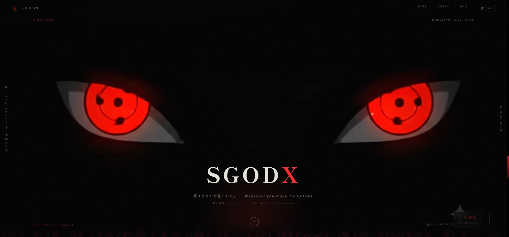

SGODX / CREATIVE FRONTEND CASE STUDY

# Uchiha Itachi — SGODX

**A dark, atmospheric browser experience built around scroll, gaze, and light.**

[Open the live experience](https://itachi-sgodx.vercel.app/) · [View the case study](https://dpsychoo.github.io/itachi-sgodx-showcase/) · [SGODX / dpsychoo](https://github.com/dpsychoo)

Presentation-only repository · Production implementation and unverified media are not included

## 1. Project overview

Uchiha Itachi — SGODX is an unofficial, Japanese-English browser experience that turns a long scroll into a sequence of visual acts: a frame-scrubbed introduction, a pointer-responsive Sharingan gaze, an atmospheric Jutsu reveal, and an end credit. The production experience combines browser-native rendering APIs with custom interaction and a third-party Ghost Cursor fragment documented in its notices.

This public repository is a presentation-only case study. It contains no production HTML, CSS, JavaScript, shaders, character frames, video, sound files, or additional production captures. One owner-approved Sharingan/SGODX cover is included; approval for this showcase does not establish blanket rights to Naruto material visible in the cover.

## 2. Live demo

[Explore the Itachi SGODX experience on Vercel](https://itachi-sgodx.vercel.app/)

The demo is hosted separately. This repository describes the experience without reproducing its character imagery or implementation.

## 3. Visual preview

The owner-approved Sharingan/SGODX cover shown above is included for this portfolio showcase. Other desktop and mobile captures remain excluded because redistribution permission for the Naruto imagery they show has not been confirmed. See the [screenshot inventory](assets/screenshots/README.md) for the capture record.

## 4. Key features

- A 71-frame main sequence mapped to scroll progress in both directions.
- A pointer- and touch-responsive gaze built from a 51-frame eye sequence and a nine-position lookup.
- A Jutsu scene with pointer-driven background reveal, parallax, and a WebGL smoke cursor.
- Canvas-rendered feather and flame layers with SVG lightning.
- Optional synthesized thunder through the Web Audio API; no audio samples are downloaded.
- Responsive layouts and a non-WebGL interaction fallback.
- Reduced-motion handling for selected atmospheric effects.

These describe the separately hosted production experience. Their source code and media are not shipped by this case study.

## 5. Verified technology stack

| Area | Technology |
| --- | --- |
| Markup and layout | HTML5 and CSS |
| Application behavior | Vanilla JavaScript; local Node.js tooling uses native ES modules |
| Main image sequence and gaze | Canvas 2D |
| Smoke pointer effect | WebGL and GLSL |
| Feather and flame effects | Canvas 2D |
| Lightning | Inline SVG |
| Thunder | Web Audio API synthesis |
| Local development | Node.js 20.16.0+ native HTTP server and static checker; no npm dependencies |
| Typefaces | Shippori Mincho, Zen Kaku Gothic New, Cinzel, and Space Grotesk via Google Fonts |

The case-study page itself uses plain HTML, CSS, SVG, and system fonts with no runtime dependency.

## 6. UI/UX and creative development

The interface uses a near-black canvas, restrained crimson accents, Japanese and English typography, and section-specific interaction. The first act reveals image frames through scroll scrubbing; the eyes section tracks pointer or touch input; and the Jutsu section couples parallax with a reveal mask and atmospheric effects.

## 7. Engineering highlights

- The primary story and gaze animation are image-sequence-driven rather than video playback.
- A measured gaze lookup orders source frames for smooth left-to-right tracking.
- WebGL smoke is optional; the Jutsu reveal and controls remain available without it.
- Sound begins disabled and is synthesized only after user interaction.
- `npm run check` validates JavaScript syntax, all 122 frame files, local references, case-sensitive paths, DOM targets, metadata, and text formatting.
- The Ghost Cursor source and license are identified in the production notice; no component code or shader is bundled here.

The case study does not claim a full audit or benchmark. Browser validation details are recorded in [docs/VALIDATION.md](docs/VALIDATION.md).

## 8. Responsive experience

The live experience adapts its layout and interaction for desktop and touch viewports. The production sequence and controls were exercised in desktop Chromium and a mobile viewport. The presentation page also reflows for narrow screens and supports the user's reduced-motion preference.

## 9. Credits and disclaimer

Uchiha Itachi and *Naruto* belong to their respective rights holders. This is an unofficial fan project and is not affiliated with, sponsored by, or endorsed by them. The production frame imagery's creator and redistribution permissions have not been established; no such media is bundled here.

The production project's [third-party notice](NOTICE.md) identifies a Ghost Cursor fragment attributed to React Bits at a pinned upstream commit and summarizes its MIT + Commons Clause terms. That code is excluded from this repository. No global license is offered while the complete rights chain for the production experience is unresolved.

## 10. SGODX / dpsychoo

Creative development and maintenance are credited to **SGODX** in the production project. Portfolio profile: [github.com/dpsychoo](https://github.com/dpsychoo).

---

**Repository scope:** presentation material only. It does not claim ownership of *Naruto* characters or production audiovisual assets.
